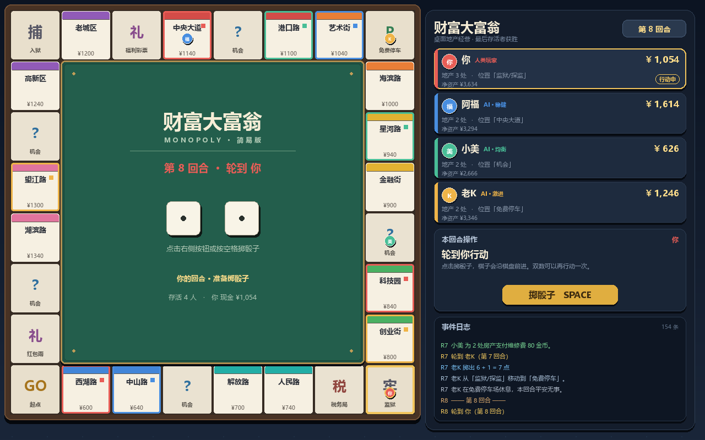

# 财富大富翁 · Monopoly

一个使用 **Python + pygame-ce** 编写的完整桌面大富翁小游戏。所有画面均由代码绘制，不依赖图片、音频或其他第三方库。

- 1 名人类玩家 + 3 名拥有不同性格的 AI
- 28 格环形棋盘，16 块可购买地产，8 个颜色地段组
- 买地、建房、收租、缴税、机会卡、监狱、破产与最终排名
- 右侧实时资产面板 + 每回合事件日志

## 环境要求

- Python **3.10 或更高版本**
- `pygame-ce >= 2.5`（本项目的唯一第三方依赖）
- 需要系统安装中文字体。Windows 默认的微软雅黑即可；Linux 建议安装 Noto Sans CJK 或文泉驿微米黑。

> 代码使用 `import pygame`，因此同样兼容 pygame 2.x；推荐安装 pygame-ce，它在 Python 3.12+ 上的支持更好。

## 安装

在项目根目录打开终端：

```bash
python -m venv .venv
```

Windows：

```powershell
.venv\Scripts\activate
```

macOS / Linux：

```bash
source .venv/bin/activate
```

安装依赖：

```bash
python -m pip install --upgrade pip
python -m pip install -r requirements.txt
```

## 运行

```bash
python main.py
```

建议窗口分辨率为 1280×800 或更高。按 `Esc` 可直接退出。

## 操作说明

| 操作 | 说明 |
| --- | --- |
| 鼠标左键 | 点击“掷骰子”“结束回合”“购买”“升级”等按钮 |
| `Space` / `Enter` | 在人类回合掷骰子或结束回合 |
| `R` | 游戏结束后再来一局 |
| `Esc` | 退出游戏 |

人类玩家落地后的决策：

- 无主地产：弹窗选择购买或放弃；现金不足时自动放弃。
- 自己的地产：可花费建造费用升一级，最高升到“酒店”。
- 其他玩家的地产：自动支付租金。
- 机会格：自动抽取机会卡并结算。
- 税务局：自动缴纳税款。
- 入狱格：被送进监狱，下一个自己的回合暂停一次。

## 规则概览

1. **回合与双数**：掷两颗骰子前进；掷出双数可额外行动一次。
2. **起点**：经过起点领取 120 金币。
3. **买地**：落在无主地产上，可按标价买入。
4. **建房**：落在自己的地产上，可升级建筑，最高 3 级（空地 → 小屋 → 洋房 → 酒店）。
5. **收租**：其他玩家落在你的地产上时，按当前等级支付租金。
6. **资金不足**：系统会自动拆除建筑、抵押地产来筹钱；仍不够则破产出局。
7. **监狱**：停在“监狱/探监”只是探监；踩到“入狱”或抽到入狱机会卡则暂停一回合。
8. **胜利条件**：最后一位没有破产的玩家获胜，界面展示完整排名。

地产价格与建造成本、租金倍率、AI 风险偏好都可以在源码顶部的常量与 `AI_STYLES` 中调整。

## 项目结构

```text
main.py             程序入口：窗口、输入分发、主循环
game_state.py       游戏状态与纯规则：棋盘、玩家、买地、建房、收租、破产
ai.py               AI 决策：三名 AI 的买地与升级策略
renderer.py         pygame 画面渲染：棋盘、棋子、侧栏、日志、弹窗
turn_manager.py     回合循环状态机：掷骰、移动动画、人机操作与阶段切换
requirements.txt    pygame-ce 依赖
README.md           本文件
```

### 模块边界

- `game_state.py` 不导入 pygame，可脱离窗口做纯逻辑测试。
- `ai.py` 只返回“买/不买”“升级/不升级”及理由，由回合控制器执行。
- `renderer.py` 只读取状态，不修改游戏规则。
- `turn_manager.py` 负责人机交互节奏与动画计时，是状态与画面之间的桥梁。

## 常见问题

**画面中的中文变成方框？**

说明系统没有找到中文字体。Windows 一般无需处理；Linux 可安装：

```bash
sudo apt install fonts-noto-cjk
```

**提示 `ModuleNotFoundError: No module named 'pygame'`？**

请确认已经激活虚拟环境并执行 `python -m pip install -r requirements.txt`，然后用同一个 Python 运行 `python main.py`。

**一局大概多久？**

AI 自动行动带节奏动画，一局通常约 10–20 分钟。想加快节奏，可调小 `turn_manager.py` 中的 `AI_ROLL_DELAY`、`AI_DECIDE_DELAY`、`AI_END_DELAY`、`ROLL_ANIM_TIME`、`MOVE_STEP_TIME`。

## 截图


